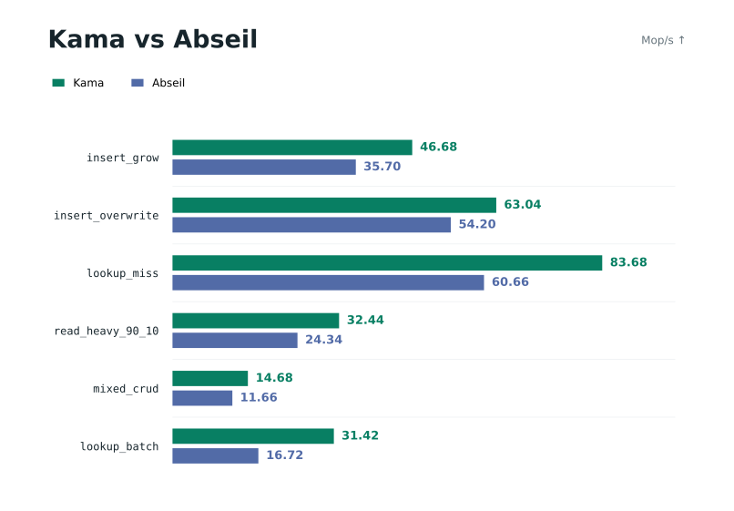
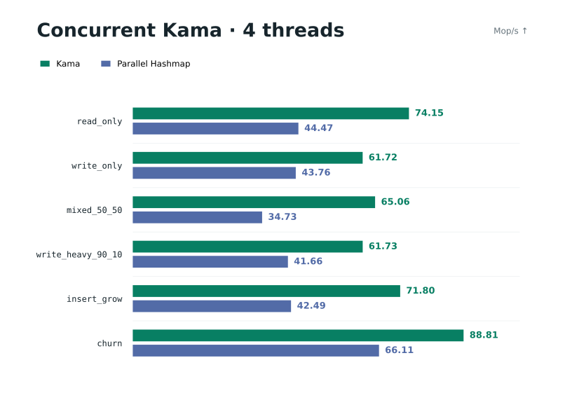

# kama

Kama is a fast C11 hash map in one header. It uses a Swiss-table layout, SIMD probing, guarded adaptive string fingerprints, embedded [RapidHash](https://github.com/Nicoshev/rapidhash), and inline storage for short keys. You can generate typed maps and sets for strings, integers, pointers, or fixed-size binary keys. C++17 works with trivial C-compatible values.

This branch ships the headers, readmes and benchmark images. The `dev` branch keeps development sources, tests and detailed benchmark records.

---

## Features

- Copy `kama.h` into your project. There is no library to link.
- `kama(mymap, int)` generates a fully typed map.
- SIMD probing uses AVX-512BW, AVX2, SSE2 or ARM NEON, with a word-at-a-time scalar fallback.
- String keys ≤ 8 bytes are copied inline, avoiding a pointer load.
- Bounded word loads compare strings of 8 to 32 bytes without reading past their buffers.
- One cached word selects built-in, custom or full hashing on common paths.
- Configurable read hints start slot and metadata fetches before control-tag checks.
- Separate helpers prepare keys before copying values. Repeated C++ overwrites can reuse the read probe.
- Bounded hashing and comparisons handle value reads, index lookups, deletion and set membership for strings up to 32 bytes.
- `kama_packed` also copies exact 16-byte keys inline.
- Maps and sets support uint32, uint64, pointer identity and fixed-size binary keys. Sets need no dummy values.
- Adaptive string hashing uses cheap first/last-word fingerprints, exact comparison and automatic full-hash fallback.
- RapidHash V3 is pinned and embedded with its license. Public hash outputs stay unchanged.
- The load factor is about 85%, with triangular probing, tombstone cleanup and direct migration.
- Allocation is lazy. Boolean results report success or failure; reserve, compact, clear and shrink control storage.
- Value pointers, entry/update results with insertion flags, prehashed operations and copying or pointer batches avoid repeated lookups.
- Long string keys can be borrowed or copied. Allocators, hash/equality hooks and statistics are configurable.
- The optional SipHash-2-4 hook accepts a secret key supplied by the caller.
- `kama_conc.h` provides independent locked shards for concurrent reads and writes. Ordinary map code and layouts are unchanged.

---

## Usage

```c
#include "kama.h"
#include <stdio.h>

// Generate a map type: binary string keys -> int values
kama(imap, int)

int main(void) {
    imap_t map;
    if (!imap_init(&map, 0)) return 1; // allocate on first write

    if (!imap_put(&map, "hello", 5, 42) ||
        !imap_put(&map, "world", 5, 99)) {
        imap_free(&map);
        return 1;
    }

    int val;
    if (imap_get(&map, "hello", 5, &val))
        printf("%d\n", val); // 42

    imap_entry_t entry = imap_entry(&map, "counter", 7);
    if (!entry.result) {
        imap_free(&map);
        return 1;
    }
    ++*entry.value; // one search; a new value starts at zero

    imap_delete(&map, "hello", 5);
    imap_free(&map);
    return 0;
}
```

Compile a saved example with `cc -std=c11 -O3 example.c -o example`. Use `c++ -std=c++17 -O3 example.cpp -o example` for C++.





The `kama(NAME, VAL_TYPE)` macro generates `NAME_t`, `NAME_entry_t`, `NAME_keyarg_t`, and the functions below. All map pointers must refer to initialized, zero-initialized, or freed objects as appropriate. Index accessors require an occupied slot.

### Initialization and capacity

| Function | Description |
| -------- | ----------- |
| `NAME_init(map, cap)` | Initialize with a slot-capacity hint; zero defers allocation |
| `NAME_init_ex(map, cap, options)` | Initialize with a `const kama_options_t *`; NULL selects defaults |
| `NAME_free(map)` | Free owned keys and table storage; reset the object |
| `NAME_reserve_entries(map, n)` | Reserve room for at least n live entries, accounting for tombstones |
| `NAME_rehash(map, cap)` | Rebuild at a rounded slot capacity large enough for existing entries |
| `NAME_resize(map, cap)` | Alias for checked `rehash` |
| `NAME_compact(map)` | Remove tombstones without changing capacity |
| `NAME_shrink_to_fit(map)` | Shrink to fit live entries; release table storage when empty |
| `NAME_clear(map)` | Remove entries and owned keys while retaining capacity and options |
| `NAME_count(map)` | Return the number of live entries |
| `NAME_empty(map)` | Return true when empty |
| `NAME_allocated_bytes(map)` | Return currently requested table and owned-key bytes, excluding allocator overhead |

`init`, `init_ex`, `reserve_entries`, `rehash`, `resize`, `compact`, and `shrink_to_fit` return `bool`: `true` on success or `false` on failure. `free` and `clear` return void. Capacities round up to a power of two and at least one probe group; capacity hints count slots, while `reserve_entries` counts entries.

`NAME_t map = {0}` is also valid. Initialize only an uninitialized or already freed object: initializing a live map leaks its allocation. A failed initialization is safely freeable. `free` can be repeated; a freed map is reusable with default options and seed zero.

### Reads and writes

| Function | Description |
| -------- | ----------- |
| `NAME_put(map, key, len, val)` | Insert or overwrite; return boolean success |
| `NAME_put_unique(map, key, len, val)` | Insert without checking for duplicates; key **must be absent** |
| `NAME_get(map, key, len, out)` | Return true on hit, false on miss; missing output stays untouched; out may be NULL |
| `NAME_contains(map, key, len)` | Return membership without copying a value |
| `NAME_get_ptr(map, key, len)` | Return a pointer to the const value, or NULL |
| `NAME_get_mut(map, key, len)` | Return a pointer to the mutable value, or NULL |
| `NAME_entry(map, key, len)` | Return `{ value, result, inserted }`; insert a zero-initialized value if absent |
| `NAME_update(map, key, len, fn, context)` | Find or insert, call `fn(value_pointer, context)`, and return boolean success |
| `NAME_delete(map, key, len)` | Return true if removed, false if absent |
| `NAME_find_idx(map, key, len)` | Return an occupied index, or `map->capacity` on miss |
| `NAME_erase_idx(map, index)` | Remove an occupied index; return true if removed, otherwise false |
| `NAME_key(map, index)` | Return the stored key; string keys are binary spans |
| `NAME_key_len(map, index)` | Return key length in bytes |
| `NAME_val(map, index)` | Return a copy of the stored value |

`put`, `put_unique`, `put_hashed`, `update`, and set insertion return `bool`. Both insertion and overwrite return `true`; failure returns `false`. Check errors with `if (!NAME_put(...))`. Inserting a key already in a set also succeeds.

`entry.result` reports boolean success; `entry.inserted` is true only when a new entry was created. On error, both flags are false and `entry.value` is NULL. The update callback has signature `void fn(VAL_TYPE *value, void *context)`; passing NULL returns false.

For compatibility, `kama_result_t` aliases `bool`, `KAMA_ERROR` aliases false, and both `KAMA_INSERTED` and `KAMA_UPDATED` alias true. Use `entry.inserted` to distinguish insertion from overwrite.

Overwriting preserves the original stored key and does not allocate or grow. Allocation failure preserves existing entries and values. An owned-key insertion may already have rebuilt the table before its key allocation fails, so even a failed write can invalidate pointers. A failed reserve/rehash allocation leaves the old table intact.

### Hash reuse and batches

| Function | Description |
| -------- | ----------- |
| `NAME_hash_key(map, key, len)` | Return a full `uint64_t` hash token |
| `NAME_find_hashed(map, key, len, hash)` | Find an index using a token; return capacity on miss |
| `NAME_get_hashed(map, key, len, hash, out)` | Lookup with the same output rules as `get` |
| `NAME_get_ptr_hashed(map, key, len, hash)` | Return a const value pointer using a token, or NULL |
| `NAME_get_mut_hashed(map, key, len, hash)` | Return a mutable value pointer using a token, or NULL |
| `NAME_contains_hashed(map, key, len, hash)` | Test membership using a token |
| `NAME_delete_hashed(map, key, len, hash)` | Remove using a token; return true if removed |
| `NAME_put_hashed(map, key, len, val, hash)` | Insert or overwrite with a token |
| `NAME_entry_hashed(map, key, len, hash)` | Entry lookup/insertion with a token |
| `NAME_get_batch(map, keys, count, values, found)` | Return hit count; prepare hashes/prefetches in chunks |
| `NAME_get_ptr_batch(map, keys, count, pointers)` | Return hit count and const value pointers; NULL on miss |
| `NAME_get_batch_pipelined(map, keys, count, values, found)` | Stage candidate reads before copying hit values |
| `NAME_get_ptr_batch_pipelined(map, keys, count, pointers)` | Stage candidate reads and return value pointers |
| `NAME_put_batch(map, keys, values, count, results)` | Return the number of completed writes; stop on failure |

Hash tokens are valid only for the same key bytes and hash configuration. Built-in string tokens always use full RapidHash V3 and remain valid across the adaptive fallback. While a map samples strings, prehashed operations derive the cheap internal fingerprint from the key; in full mode they use the supplied token directly. Custom hash callbacks are never called by prehashed reads or deletion. These operations still check keys and manage capacity when writing.

Batch keys are `NAME_keyarg_t`: `kama_key_t { const char *data; size_t len; }` for strings, the scalar key type for integer/pointer maps, or `const void *` for fixed keys. `get_batch` accepts optional value output and `uint8_t found[]` arrays; missing values remain untouched. `put_batch` requires input values; its `bool results[]` output is optional. On failure, earlier writes remain, `results[completed]` is false when supplied, and later results are untouched. Batch writes are not atomic.

`get_ptr_batch` avoids copying values. Its optional output array receives the same pointer type as `get_ptr`, with NULL for every miss. Passing NULL returns only the hit count. Returned pointers follow the same invalidation rules as single-key value pointers. For the `imap` above:

```c
kama_key_t queries[] = {{"hello", 5}, {"world", 5}};
const int *values[2];
size_t hits = imap_get_ptr_batch(&map, queries, 2, values);
printf("%zu hits\n", hits);
if (values[0]) printf("%d\n", *values[0]);
```

The `_pipelined` reads stage control groups, candidate slots, and long-key bytes before resolving each chunk. They are intended for large tables with many hits; ordinary batch reads can be faster for cached tables or mostly misses. Copying and missing-output rules match their ordinary counterparts. Calls with fewer than four queries, or with `KAMA_BATCH_SIZE < 4`, use the ordinary path. All batch reads return a hit count; count zero accepts NULL arrays.

Input/output arrays must not overlap storage that a map mutation can invalidate. Input key bytes must stay valid throughout the batch.
For pipelined reads, keep output arrays separate from query descriptors and key bytes.

---

## Key variants

| Macro | Key argument | Storage |
| ----- | ------------ | ------- |
| `kama(NAME, VALUE)` | `const char *key, size_t len` | Separate metadata; keys ≤ 8 bytes inline; balanced default |
| `kama_soa(NAME, VALUE)` | `const char *key, size_t len` | Explicit name for the default layout |
| `kama_aos(NAME, VALUE)` | `const char *key, size_t len` | Metadata beside each key/value pair |
| `kama_packed(NAME, VALUE)` | `const char *key, size_t len` | Colocated metadata; keys ≤ 8 bytes and exactly 16 bytes inline |
| `kama_u32(NAME, VALUE)` | `uint32_t key` | Inline integer key, no metadata array |
| `kama_u64(NAME, VALUE)` | `uint64_t key` | Inline integer key, no metadata array |
| `kama_ptr(NAME, VALUE)` | `const void *key` | Pointer identity; NULL is a valid key |
| `kama_fixed(NAME, N, VALUE)` | `const void *key` | Exactly N readable bytes copied inline; N must be positive |

Integer, pointer and fixed-key maps have the same functions as string maps, with the `len` argument omitted. Integer/pointer keys are returned by value from `NAME_key`; fixed keys return a `const void *` byte span. Integer and pointer maps use specialized mixers by default. Fixed keys use RapidHash, with cached seed preparation for sizes up to 16 bytes.

### Integer key variant

```c
#include "kama.h"
#include <stdio.h>

kama_u32(ids, float)

int main(void) {
    ids_t map = {0};
    if (!ids_put(&map, 42, 3.14f)) {
        ids_free(&map);
        return 1;
    }

    float val;
    if (ids_get(&map, 42, &val))
        printf("%.2f\n", val); // 3.14

    ids_delete(&map, 42);
    ids_free(&map);
    return 0;
}
```

### Sets

Every layout has a set generator: `kama_set(NAME)`, `kama_soa_set(NAME)`, `kama_aos_set(NAME)`, `kama_packed_set(NAME)`, `kama_u32_set(NAME)`, `kama_u64_set(NAME)`, `kama_ptr_set(NAME)`, and `kama_fixed_set(NAME, N)`. Sets have no value field.

| Set function | Description |
| ------------ | ----------- |
| `NAME_insert(map, key, len)` | Return true if inserted or already present, false on failure |
| `NAME_insert_hashed(map, key, len, hash)` | Insert with a hash token |
| `NAME_contains(map, key, len)` | Return membership |
| `NAME_contains_hashed(map, key, len, hash)` | Test membership using a token |
| `NAME_delete_hashed(map, key, len, hash)` | Remove using a token |
| `NAME_contains_batch(map, keys, count, found)` | Return hit count; optional `uint8_t found[]` |
| `NAME_contains_batch_pipelined(map, keys, count, found)` | Stage candidate reads; same output and hit-count rules |
| `NAME_insert_batch(map, keys, count, results)` | Return completed count; same partial-failure rules as `put_batch` |

Sets also expose all initialization/capacity functions, `delete`, `erase_idx`, `hash_key`, `find_idx`, `find_hashed`, `key`, `key_len`, and iteration. Omit `len` for integer/pointer/fixed sets. Value accessors, `put`, `entry`, and `update` are map-only.

---

## Key ownership and options

Short keys are copied inline. String keys ≤ 8 bytes are always stored inline. Longer keys are borrowed by default and must remain alive and immutable until removed. Overwriting an entry with an equal key preserves the original key buffer.

Packed keys. `kama_packed` additionally copies exact 16-byte keys into the pair's existing key/metadata words. A one-bit-per-slot bitmap preserves all key patterns and all seven control-tag bits. Lengths 9 to 15 and 17+ follow ordinary borrowed/owned behavior. Inline 16-byte keys are rehashed during migration. With uint64 values, packed storage uses 25.125 bytes per capacity slot versus 25 for the default, excluding the common control clone tail and alignment padding: about 0.5% more.

Owned strings. Pass `copy_keys = 1` in `kama_options_t` to copy long string keys too. These copies are also NUL-terminated, but their explicit binary length determines identity. Fixed keys are always copied. Pointer maps store the pointer value and never own its pointee. Values are assigned by value and are never automatically destroyed or freed.

A single write can copy an owned key from a stored value, even when growth or a hash-policy switch moves that value. Such an alias uses a temporary snapshot on the rebuild path and can fail if that allocation fails. A value supplied by value is also preserved across rebuilding. Borrowed long keys still require storage that remains valid after the call; batch input arrays must follow the separate lifetime rules above.

`kama_options_t` is copied by `NAME_init_ex`; start with `{0}` and set the fields needed:

| Field | Description |
| ----- | ----------- |
| `allocate`, `deallocate` | Custom allocator pair; provide both or neither |
| `allocator_context` | Borrowed context for allocation callbacks |
| `seed` | Deterministic 64-bit hash seed; zero by default |
| `copy_keys` | Nonzero copies long string keys |
| `hash` | Optional `uint64_t fn(const void *key, size_t len, uint64_t seed, void *context)` |
| `equal` | Optional `int fn(const void *a, const void *b, size_t len, void *context)`; nonzero means equal |
| `key_context` | Borrowed context for hash/equality callbacks |
| `stats` | Optional pointer to zero-initialized `kama_stats_t`; requires `KAMA_ENABLE_STATS` |
| `hash_policy` | `KAMA_HASH_ADAPTIVE` (zero/default) or `KAMA_HASH_FULL`; applies to built-in string hashing |

Adaptive strings. The default initially fingerprints the first and last words, then compares complete keys. If an insertion encounters unequal keys with the same complete 64-bit fingerprint, the map rebuilds with full RapidHash V3 and stays in full mode, including after `clear`. A match in the cached 39 bits alone does not trigger a switch. Custom hash or equality callbacks disable sampling; integer, pointer, and fixed-key maps retain their existing hashes.

The one-time fallback can allocate and move entries even when capacity was reserved. If its allocation fails, the old table and policy remain intact. A successful fallback can precede another allocation failure, so a failed write may still invalidate pointers. Read-only operations never switch policy. To select full hashing from initialization:

```c
kama_options_t options = {0};
options.hash_policy = KAMA_HASH_FULL;
imap_t map;
if (!imap_init_ex(&map, 0, &options)) return 1;
```

Full mode is useful for predictable allocation behavior, repeated prehashed access, or key sets whose differences are mainly in their middles. The adaptive path improves many mixed-string read workloads; it has insertion tradeoffs documented in the performance report on `dev`.

Allocation callbacks have signatures `void *allocate(void *context, size_t bytes, size_t alignment)` and `void deallocate(void *context, void *ptr, size_t bytes, size_t alignment)`. Allocation must honor the requested power-of-two alignment and return NULL on failure.

Equal keys must have identical complete hashes. String equality is called only for equal lengths. Integer/pointer hash and equality hooks receive the key's object bytes; fixed-key hooks receive its N bytes. Keep callback contexts and statistics alive for the map's lifetime. Set options through `init_ex`; free and reinitialize to change them. Keep hash/equality callback behavior stable while entries exist.

Statistics include `probe_groups`, `key_comparisons`, `rehashes`, `migrated_entries`, `allocated_bytes`, and `peak_allocated_bytes`. Reads update probe/comparison counters. Allocation counters track requested bytes, including temporary old/new tables during migration; they exclude allocator overhead and caller-owned data.

For SipHash-2-4, set `options.hash = kama_siphash24` and `options.key_context` to a live `kama_siphash_key_t { k0, k1 }` containing a caller-supplied secret 128-bit key. The options seed is XORed into the first key word. A public seed or fixed public key does not protect against attacker-selected collisions.

---

## Iteration

`kama_foreach` scans occupied indices, skipping empty and deleted slots. String/fixed keys are byte spans, not necessarily NUL-terminated strings. For an `imap` declared in the usage example:

```c
kama_foreach(&map, i) {
    fwrite(imap_key(&map, i), 1, imap_key_len(&map, i), stdout);
    printf(": %d\n", imap_val(&map, i));
}
```

`NAME_erase_idx(map, i)` can remove the current entry during iteration: deletion does not move other entries. Do not insert, reserve, rehash, compact, shrink or clear while continuing an existing index iteration. Use `NAME_key` and `NAME_key_len` rather than interpreting packed entries' raw fields.

Pointers into slots can be invalidated by growth/rebuild, clear, free, or deletion of the pointed-to entry. An update callback must not invalidate its supplied value pointer while using it. Stored keys must never be modified in place.

---

## Concurrent maps

Include `kama_conc.h` when several threads need to read and write the same map. It divides the map into 128 independently locked shards, hashes keys before locking, and grows each shard separately. Threads on different shards can run at the same time. Ordinary `kama.h` has no extra locks, atomic counters or runtime branches.

```c
#include "kama_conc.h"

kama_conc(counters, uint64_t)

static void increment(uint64_t *value, void *context) {
    (void)context;
    ++*value;
}

int main(void) {
    counters_t map;
    if (!counters_init(&map, 0)) return 1; // before starting workers

    // Workers can call these APIs concurrently, using their own keys/outputs.
    bool ok = counters_update(&map, "requests", 8, increment, NULL);
    uint64_t value = 0;
    bool found = counters_get(&map, "requests", 8, &value);

    counters_free(&map); // after all workers have stopped
    return ok && found && value == 1 ? 0 : 1;
}
```

`kama_conc_u32`, `kama_conc_u64`, `kama_conc_ptr` and `kama_conc_fixed(NAME, N, VALUE)` provide specialized keys. `kama_conc_soa`, `kama_conc_aos` and `kama_conc_packed` select string layouts. Concurrent maps use full hash tokens to route and probe once; built-in strings use full RapidHash. Long keys are borrowed by default, or copied with `options.map.copy_keys = 1` in `kama_conc_options_t`.

| Concurrent API | Behavior |
| -------------- | -------- |
| `NAME_init`, `NAME_init_ex`, `NAME_free` | Initialize before sharing; free after all users stop; no concurrent lazy initialization |
| `NAME_put`, `NAME_get`, `NAME_contains`, `NAME_delete` | Individually atomic operations; `get` copies the value under its shard lock |
| `NAME_update(map, key, len, fn, context)` | Atomically find or insert a zero value and call `void fn(VALUE *, void *)` |
| `NAME_visit(map, key, len, fn, context)` | Call `void fn(VALUE const *, void *)` on a hit while holding its lock |
| `NAME_hash_key` and `_hashed` operations | Reuse tokens for put/get/contains/delete/update/visit |
| `NAME_count`, `NAME_empty`, `NAME_capacity`, `NAME_allocated_bytes` | Exact aggregate snapshots; acquire all shards |
| `NAME_clear`, `NAME_reserve_entries`, `NAME_compact`, `NAME_shrink_to_fit` | Maintenance with all shards locked; reservation distributes a budget across shards |
| `NAME_get_stats` | Snapshot statistics stored separately in each shard; requires `KAMA_ENABLE_STATS` |
| `NAME_for_each` | Locked callbacks one shard at a time; traversal can observe changes in other shards |

Omit `len` for specialized keys. Mutations return boolean success. Use `update` for an atomic read/modify/write; separate `get` and `put` calls are separate operations. Callback pointers are valid only during their call, and callbacks must not reenter the same map. Custom allocators and hash/equality hooks must be thread-safe. Keep borrowed keys alive and immutable, and initialize/join/free using the application's synchronization.

Build POSIX applications with `-pthread`. In the `dev` source checkout, CMake users enable `-DKAMA_BUILD_CONCURRENT=ON` and link `kama::conc`; installed consumers use `find_package(kamaConc CONFIG REQUIRED)`. The normal CMake target retains its existing dependencies. `KAMA_CONC_SHARDS` and `options.shards` tune contention. Supported Apple targets use `os_unfair_lock`; other POSIX targets use pthread mutexes, and Windows uses SRW locks. Define `KAMA_CONC_NATIVE_LOCK=0` for the pthread fallback, or `KAMA_CONC_RWLOCK=1` for shared reads within a shard. Statistics builds take exclusive read locks to protect counters. A single hot key still serializes; the map does not create threads itself.

See the [concurrent API and multithreaded example](README_CONCURRENT.md). The `dev` branch keeps the peer benchmark records and validation logs.

Against mutex-enabled Parallel Hashmap v2.0.0, current concurrent Kama wins 34/36 workload/thread combinations (94.4%) on the measured ARM64 macOS host. Against the same peer using Kama's RapidHash and native lock, it wins 31/36 (86.1%). These are pooled medians across three complete passes, covering nine workloads and 1/2/4/8 workers; all results, pass ranges and slower cases are retained in the report.

Four-worker throughput (Mop/s, higher is better), with mixed 8/9/15/16/17/32/64-byte strings:

| Benchmark | Concurrent Kama | Phmap | Phmap with shared hash/lock |
| --------- | --------------: | ----: | -------------------------: |
| Read hits | 74.15 | 44.47 | 62.84 |
| Read misses | 90.31 | 72.51 | 89.41 |
| Overwrite | 61.72 | 43.76 | 63.11 |
| Mixed 50% writes | 65.06 | 34.73 | 52.52 |
| Write-heavy 90% writes | 61.73 | 41.66 | 57.20 |
| Insert with growth | 71.80 | 42.49 | 63.05 |
| Insert after reservation | 108.22 | 59.92 | 122.71 |
| Delete/reinsert churn | 88.81 | 66.11 | 86.85 |
| One-key atomic update | 14.91 | 27.10 | 10.93 |

With four workers, concurrent reads are 1.30× faster, overwrites 1.23× faster and cold insertion 1.73× faster than the previous concurrent header, rebuilt with the same harness. Native lock scheduling performs worse when threads fight over one key; use the pthread fallback for that workload. Insertion and mixed-operation timings vary across passes, so check the full ranges before relying on a close result. All 27 ASan/UBSan CTests, nine ThreadSanitizer configurations, peer adapter sanitizer checks and existing x86 Docker checks passed. Ordinary Kama's sources and optimized assembly controls are unchanged.

---

## Benchmarks

Measured the default `kama` string map against Abseil's `flat_hash_map<absl::string_view, uint64_t>` on the same verified operation traces. Higher Mop/s and lower ns/op are better. Δ vs abseil is Kama's throughput difference: positive favors Kama, negative favors Abseil.

Each row uses the complete pass with Kama's best throughput ratio to Abseil, out of three passes. Both numbers come from that same pass and the same three seeded traces, with nine timed samples per implementation. Different rows can use different passes. This favors Kama; the ranges and pooled results below show how much the runs vary.

```text
┌────────────────────────┬────────────┬───────────┬────────────┬───────────┬─────────────┐
│                        │       kama │      kama │     abseil │    abseil │        Δ vs │
│ Benchmark              │      Mop/s │     ns/op │      Mop/s │     ns/op │      abseil │
├────────────────────────┼────────────┼───────────┼────────────┼───────────┼─────────────┤
│ insert_grow            │      46.68 │      21.4 │      35.70 │      28.0 │      +30.8% │
│ insert_prealloc        │      72.74 │      13.7 │      70.24 │      14.2 │       +3.6% │
│ insert_overwrite       │      63.04 │      15.9 │      54.20 │      18.5 │      +16.3% │
│ lookup_hit             │      52.46 │      19.1 │      49.05 │      20.4 │       +6.9% │
│ lookup_miss            │      83.68 │      12.0 │      60.66 │      16.5 │      +37.9% │
│ lookup_mixed           │      60.27 │      16.6 │      54.25 │      18.4 │      +11.1% │
│ lookup_tombstone       │      46.31 │      21.6 │      43.62 │      22.9 │       +6.2% │
│ delete_all             │      40.79 │      24.5 │      39.61 │      25.2 │       +3.0% │
│ delete_random_half     │      14.39 │      69.5 │      13.49 │      74.1 │       +6.6% │
│ churn                  │      14.28 │      70.0 │      13.24 │      75.5 │       +7.9% │
│ read_heavy_90_10       │      32.44 │      30.8 │      24.34 │      41.1 │      +33.3% │
│ write_heavy_10_90      │      77.84 │      12.8 │      79.12 │      12.6 │       -1.6% │
│ mixed_crud             │      14.68 │      68.1 │      11.66 │      85.8 │      +25.9% │
│ zipfian_hotpath        │      25.70 │      38.9 │      23.73 │      42.1 │       +8.3% │
│ insert_fixed_16b       │      80.37 │      12.4 │      73.03 │      13.7 │      +10.0% │
│ lookup_shuffled        │      16.91 │      59.2 │      15.39 │      65.0 │       +9.8% │
│ lookup_batch           │      31.42 │      31.8 │      16.72 │      59.8 │      +87.9% │
│ dependent_lookup       │       4.15 │     241.0 │       4.04 │     247.5 │       +2.7% │
│ steady_churn           │      14.88 │      67.2 │      13.65 │      73.3 │       +9.0% │
└────────────────────────┴────────────┴───────────┴────────────┴───────────┴─────────────┘
```

Setup: macOS 27.0 ARM64, Apple Clang 21.0.0 (`clang-2100.3.34.2`), Abseil 20250814.1 (pkg-config: 20250814), C++17, `-O3 -DNDEBUG -march=native`, uint64 values, C++ defaults (outlined writes, adaptive update probing, 32-query batches), and Kama statistics disabled. C keeps inline writes and 16-query batches; its separate controls are in the write report. The installed Abseil library is linked through pkg-config. Both adapters use their normal default hashes: guarded adaptive string fingerprints with seed zero for Kama (automatic RapidHash V3 fallback), and Abseil's per-table-seeded default `absl::Hash`. Public Kama hash tokens remain RapidHash V3.

Keys and capacity: 838,860 entries, with lengths 8, 9, 15, 16, 17, 32 and 64 bytes mixed within each map. Preallocated workloads use 1,048,576 slots for Kama and Abseil's corresponding 1,048,575-slot capacity, giving approximately 80% occupancy when filled. Both begin `insert_grow` without allocation. Requested table storage at the preallocated capacity is 26,214,416 bytes for Kama and 26,214,392 for Abseil; key buffers and allocator overhead are excluded. Workloads may grow or delete entries during timing. In the churn workloads both tables grow to roughly twice their starting capacity.

Repetitions: three complete passes, each with seeds 12345678, 424242 and 8675309, one warmup and three measured iterations per seed. Process order and workload order are shuffled between passes. There are 1,026 verified timed samples across the 19 workloads and both current implementations. The raw record also retains 513 saved-header samples, excluded from this table. Ordinary rows include the same trace dispatch and checksum work for both implementations; key generation, setup and reference-model validation are outside timing. Raw data, stability summaries and reproduction instructions stay on `dev`.

Workload details: long keys are borrowed in both maps; equal lookup keys use independent buffers, and misses use disjoint keys. `insert_fixed_16b` uses uniformly 16-byte strings in both ordinary string maps, not a specialized fixed-key container. `lookup_batch` measures Kama's `get_ptr_batch_pipelined` against repeated Abseil `find` calls; both consume value pointers without copying complete values; the other lookup rows use single-key calls. `churn` alternates erases and new inserts for two rounds; `steady_churn` runs eight. Values and final key presence are checked against the same reference model for every run.

Across all three passes, Kama leads in 18 of 19 workloads by pooled median; individual passes lead in 17/19, 18/19, 15/19. The winner changes between passes for `insert_prealloc`, `lookup_hit`, `delete_all`, `dependent_lookup`. Pooled gaps are below 2% for `insert_prealloc`, `delete_all`, `dependent_lookup`. The pooled count meets the 90% target, but individual passes do not consistently reach 18/19. `kama_packed` remains available when many keys are exactly 16 bytes.

Shuffled-lookup pass medians range from 56.69 to 59.15 ns/op for Kama and 60.17 to 64.97 ns/op for Abseil. Growing insertion ranges from 21.22 to 21.42 ns/op for Kama and 27.06 to 28.01 ns/op for Abseil. The table does not average the passes. Processes request user-initiated macOS QoS; CPU affinity, frequency and background activity are uncontrolled. These are measurements on one host, not guarantees for every workload or CPU. No cycle counts are estimated, and no native x86 speed claim is made.

The `dev` branch also keeps the focused C, shared-end, large-value and batch comparisons, including slower cases and rejected experiments.

### Validation

The native suite passed 27 ASan/UBSan CTests and nine ThreadSanitizer configurations. It covers collisions, allocation failures, ownership, aliases, batch reads, SIMD/scalar layouts and concurrent operations. Default and packed maps each passed 10,000 deterministic fuzz inputs with both inline and outlined writes (40,000 total).

GCC 15.2 C11, G++ C++17 and UBSan checks passed in the existing amd64 Docker image under OrbStack emulation. SSE2 and scalar paths ran; AVX2 and AVX-512 compiled but could not run because the emulator did not expose their flags. Physical x86 performance and AVX runtime validation remain unmeasured.

---

## How it works

Control bytes. Each slot has a 1-byte tag: `0xFF` (empty), `0xFE` (deleted), or the top seven hash bits. Probing compares a full group of tags at once. A cloned tail permits groups to wrap across the end of the table.

Collision resolution. Triangular probing visits groups of `KAMA_GROUP_WIDTH` bytes. Matching tags select candidates for key comparison; unequal candidates never terminate the search. Default string maps also check cached length and hash bits. An empty byte ends a search only after all candidate matches in that group are checked.

String hashing and lookups. Adaptive strings use a folded first/last-word fingerprint and full key comparison. An insertion that confirms a complete fingerprint collision rebuilds with full RapidHash. Value reads, index lookups, deletion, set membership, and prehashed reads have bounded comparison paths through 32 bytes. Full mode reuses the prepared RapidHash seed for short keys. Pointer getters keep the general long-key/custom-callback path in a separate helper. A cached key-mode word selects these paths, and full short-key hashing has separate helpers to keep the sampled path compact. Public hash tokens and key ownership rules remain unchanged.

Read hints. Single-key reads hint the home slot and separate metadata before loading control tags. Batch hints use temporal locality 3 by default. Insertion skips the read hints; both settings are configurable.

Write preparation. C++ defaults to separate key-preparation helpers, leaving the final value assignment in the caller. After eight consecutive existing-key `put` calls, built-in string maps try the read probe first; an absent key resumes the normal insertion path. Custom hash/equality hooks keep the normal preparation path. The hint changes performance only: insertion, ownership and allocation-failure rules remain the same. C defaults to inline preparation because outlining regressed the direct C control workloads.

Key storage. The default separates metadata from values so misses can reject candidates without fetching large values. Short strings, fixed keys and integers avoid external key-pointer loads. Packed strings reuse the key/metadata area for exact 16-byte keys.

Known-unique insertion. `put_unique` skips duplicate checks. With full/custom hashing it stops at the first reusable slot, including a tombstone. Adaptive mode continues far enough to detect a sampled-fingerprint collision before inserting. The caller must guarantee that the key is absent.

Deletion and migration. Deletion marks a slot empty only when doing so preserves every overlapping probe window; otherwise it leaves a tombstone. Capacity management distinguishes live occupancy from tombstone pressure and can compact without growing. Migration uses a dedicated vacancy-only path. Overwriting an existing entry never grows the table.

---

## SIMD support

| Architecture | Native group width | Intrinsics |
| ------------ | ------------------ | ---------- |
| AVX-512BW | 64 bytes | `_mm512_*` |
| AVX2 | 32 bytes | `_mm256_*` |
| SSE2 | 16 bytes | `_mm_*` |
| ARM NEON | 16 bytes; optional 8 | `vceqq_u8`, narrowing and sparse masks |
| Scalar | 8 when forced; otherwise the selected width | Word-at-a-time C; supports 8/16/32/64 |

Selection is at compile time, with no runtime dispatch. The header never changes compiler ISA flags; use target flags appropriate for deployment CPUs. Unsupported requested widths fall back to scalar code.

Define tuning options before including `kama.h`:

| Option | Default / effect |
| ------ | ---------------- |
| `KAMA_GROUP_WIDTH` | 64 with AVX-512BW, 32 with AVX2, otherwise 16; scalar/NEON8 overrides below; accepts 8/16/32/64 |
| `KAMA_FORCE_SCALAR` | Force scalar probing; defaults to width 8 unless explicitly overridden |
| `KAMA_NEON8` | Select width 8 when width is not explicitly set and AVX is not selected; intended for NEON |
| `KAMA_LINEAR_PROBING=1` | Use linear probing instead of triangular |
| `KAMA_READ_PREFETCH` | Default 1: hint likely slots and metadata on single-key reads; set 0 to disable |
| `KAMA_PREFETCH_LOCALITY` | Default 3: temporal locality for all hints; accepts 0 through 3 |
| `KAMA_LOOKUP_PREFETCH` | Default 0: no additional hints; 1: controls; 2: controls and metadata/slots |
| `KAMA_LOAD_PERCENT` | Default 85; accepts 25 through 95 |
| `KAMA_OUTLINE_WRITES` | Default 1 in C++, 0 in C: separate ordinary string-map `put` preparation from value copying; also outline owned-key deletion |
| `KAMA_ADAPTIVE_PUT` | Defaults to `KAMA_OUTLINE_WRITES`: use the read probe after eight existing-key `put` calls; requires outlined writes |
| `KAMA_BATCH_SIZE` | Default 32 in C++, 16 in C: independent queries per chunk; must be positive |
| `KAMA_SEED` | Default zero; seed used by explicit initialization with default options |
| `KAMA_ENABLE_STATS` | Compile in statistics updates when an options stats pointer is supplied |

A zero-initialized or freed object uses seed zero regardless of `KAMA_SEED`. All translation units sharing map objects must use the same header and configuration. Measure wider groups, prefetch settings and alternative layouts with your application's workload.

Read hints improve several large-table workloads on the measured host, but can add overhead on tiny cached maps and misses. `KAMA_READ_PREFETCH=0` disables the new single-key hints; also set `KAMA_PREFETCH_LOCALITY=1` to restore the previous locality setting for batch and optional lookup hints. New-key insertion does not issue the read hints. Compilers without the prefetch builtin keep the same lookup behavior without hardware hints.

---

## Caveats

- Borrowed keys need stable storage. Long strings are borrowed unless copying is enabled; packed exact 16-byte keys are an inline exception.
- Binary lengths are explicit. String lengths 0 through UINT32_MAX are supported. NULL is valid only for a zero-length string, or as a pointer-identity key.
- C++ values must be trivial. No constructors or destructors run. Use a typedef when a value type contains commas.
- Ordinary maps need external synchronization for mutation. Immutable ordinary maps can be read concurrently if callbacks are safe and statistics are disabled or NULL. Use the separate `kama_conc.h` types for concurrent mutation.
- Pointers are not stable across rebuilds. Use the documented invalidation rules for value pointers, key spans and indices.
- Capacity is bounded. At most 2^32 slots on 64-bit targets; 32-bit targets and allocation sizes impose lower limits. Overflow checks return failure.
- Recompile existing consumers. Hash outputs and object layouts changed from older versions. Writes return boolean success, including overwrites; the old private `put_hashed` signature with a truncated hash and separate tag has changed to the full-token API above.

---

## License

MIT. The complete license, the embedded RapidHash MIT notice, and the altered FoldHash fingerprint's Zlib notice are included in `kama.h`. See [third-party notices](THIRD_PARTY_NOTICES.md).
